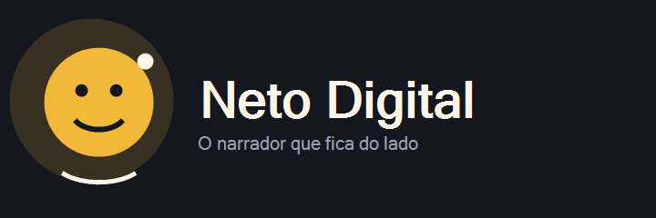
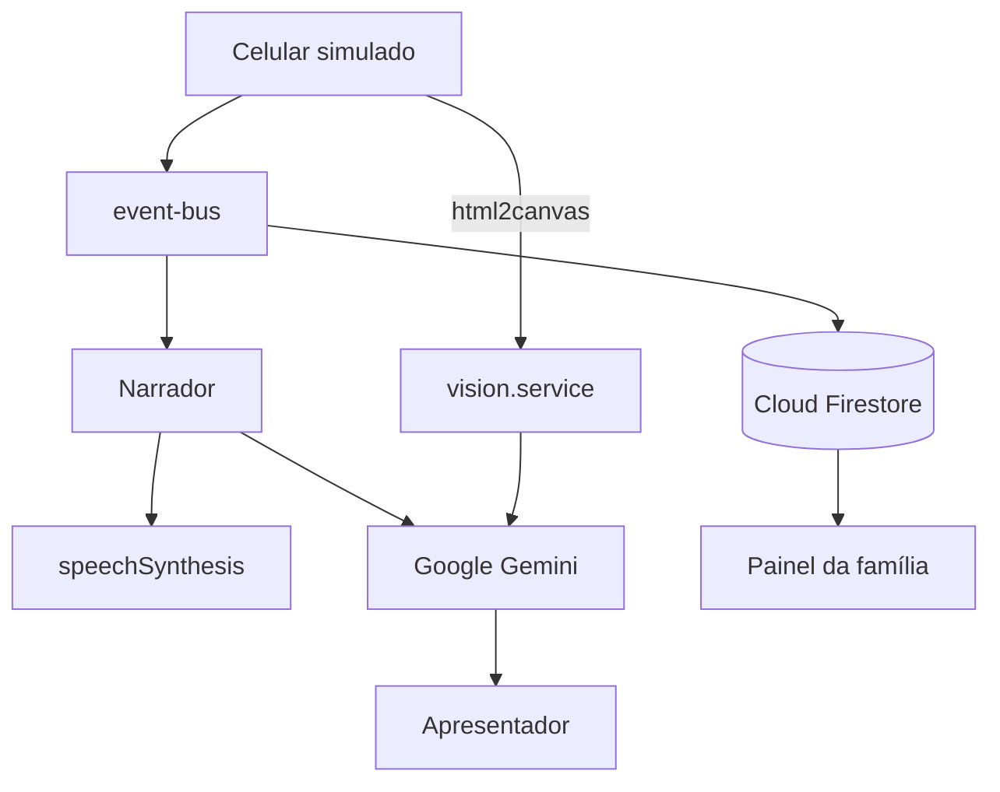

<div align="center">



# Neto Digital
### O narrador que fica do lado

[](https://developer.mozilla.org/docs/Web/HTML)
[](https://developer.mozilla.org/docs/Web/CSS)
[](https://developer.mozilla.org/docs/Web/JavaScript)
[](https://getbootstrap.com/)
[](https://firebase.google.com/)
[](https://ai.google.dev/)
[](LICENSE)
[](#)

Aplicativos modernos não foram feitos para as mãos que mais precisam de calma.  
O **Neto Digital** acompanha o idoso no celular e fala, em português simples, o que está acontecendo — antes que o golpe aconteça.

### Preview online (Vercel)

**[https://netodigital.vercel.app](https://netodigital.vercel.app)** — no **computador**, abre a demo do **celular simulado** (Dona Gina). Sem suas chaves no deploy, IA/Cloud podem cair no modo local.

> A experiência **completa** (sua chave Gemini + Firestore de verdade) continua sendo no **PC local** — veja [Como rodar](#como-rodar).


</div>

## Sumário

- [Preview online (Vercel)](#preview-online-vercel)
- [Sobre o projeto](#sobre-o-projeto)
- [Funcionalidades](#funcionalidades)
- [Requisitos da Global Solution](#requisitos-da-global-solution)
- [Arquitetura](#arquitetura)
- [Stack](#stack)
- [Como rodar](#como-rodar)
- [Estrutura de pastas](#estrutura-de-pastas)
- [Segurança e privacidade](#segurança-e-privacidade)
- [ODS da ONU](#ods-da-onu)
- [Roadmap](#roadmap)
- [Autor](#autor)
- [Licença](#licença)

## Sobre o projeto

Muitos idosos travam em telas pequenas, erram dígitos, não sabem o próximo passo e caem em golpes de falso parente ou falsa central. O problema não é “falta de vontade”: é **desigualdade digital** misturada com interfaces hostis e criminosos que exploram a urgência.

A inspiração é a **Dona Gina**, 78 anos, pouca familiaridade com tecnologia, que quer ligar para o neto Cesar, ler uma mensagem da filha Ana e não entregar a senha do banco para um estranho.

O Neto Digital é uma proposta **CitizenTech**: tecnologia a serviço do cidadão, começando pela necessidade real (autonomia e segurança) e só depois escolhendo as ferramentas (visão, IA, dados e nuvem).

## Funcionalidades

- 🗣️ **Narrador em voz alta** (Web Speech API, pt-BR) com fila e prioridades
- 👁️ **Visão da tela** com html2canvas + Gemini (JSON do que “vê”)
- 🛡️ **Alerta de golpe** em ligação e em mensagens (falso parente / número denunciado)
- 📵 **Silenciar** por botão, toque longo ou sacudir (tecla **M** no desktop)
- 🤫 **Modo discreto** com legenda grande e vibração quando disponível
- 📊 **Painel da família** com Chart.js, linha do tempo e CSV
- ☁️ **Firestore em tempo real** com fallback em localStorage
- 🎬 **Painel do apresentador** com selos dos 4 requisitos da GS

## Requisitos da Global Solution

| Tecnologia | Onde aparece no código | O que faz de verdade |
|------------|------------------------|----------------------|
| Visão Computacional | `js/services/vision.service.js` | Captura `#phone-bezel` e envia imagem ao Gemini |
| Inteligência Artificial | `js/services/gemini.service.js`, `js/narrator/scam-detector.js` | Orientação, JSON de tela e classificação de risco |
| Análise de Dados | `js/dashboard/metrics.js`, `painel.html` | Tempo por tarefa, erros, hesitação, golpes |
| Cloud | `js/services/firebase.service.js`, `firestore.rules` | Sessões, eventos e alertas no Firestore |

## Arquitetura



Detalhes em [docs/arquitetura.md](docs/arquitetura.md).  
Roteiro do vídeo em [docs/roteiro-demo.md](docs/roteiro-demo.md).

## Stack

| Camada | Tecnologia |
|--------|------------|
| Interface | HTML5, CSS3, Bootstrap 5 (CDN) |
| Lógica | JavaScript ES modules (sem build / sem npm) |
| Voz | Web Speech API (`speechSynthesis`) |
| IA | Google Gemini `gemini-2.5-flash` (camada reaproveitada do NexaTalk IA) |
| Visão | html2canvas (CDN) |
| Gráficos | Chart.js (CDN) |
| Nuvem | Firebase JS SDK modular — **somente Firestore** |
| Hosting | Vercel (demo) · Firebase Hosting (opcional) |

## Como rodar

### Importante: local × Vercel

| Onde | O que você vê |
|------|----------------|
| **No seu computador (recomendado)** | Demo **completa** com **suas** chaves: celular, narrador, IA Gemini real, Firestore, painel |
| **[netodigital.vercel.app](https://netodigital.vercel.app)** | Mesma UI do celular no PC; sem `config.js` no Git, usa fallback (narrador local / cloud offline). Bom pra abrir rápido — banca e vídeo preferem o local |

**Não precisa** abrir no celular físico. Abra a Vercel no **Chrome/Edge do computador**, clique em **Começar a demonstração** e entra na tela de bloqueio do aparelho simulado.

### Pré-requisitos (local)

- Navegador moderno (**Chrome** ou **Edge** — melhor suporte à voz)
- [VS Code](https://code.visualstudio.com/) + extensão **Live Server** (módulos ES **não** abrem com `file://`)
- Conta Google: crie **sua própria** chave no [Google AI Studio](https://aistudio.google.com/)
- Projeto Firebase com Firestore (pode usar o seu; sem nuvem a demo cai em `localStorage`)

### Passos (local)

```bash
# 1. Clone o repositório
git clone https://github.com/eucesar/Neto_Digital.git
cd Neto_Digital

# 2. Copie o arquivo de configuração de exemplo
# Git Bash / Linux / macOS:
cp js/config/config.example.js js/config/config.js

# Windows PowerShell (alternativa):
# Copy-Item js\config\config.example.js js\config\config.js

# 3. Edite js/config/config.js e preencha COM AS SUAS CHAVES:
#    - GEMINI_API_KEY   → sua chave do Google AI Studio
#    - firebaseConfig   → seu projeto Firebase

# 4. No VS Code, abra a pasta do projeto e inicie o Live Server
#    em index.html (porta típica: http://127.0.0.1:5500)

# 5. (Opcional) Painel da família:
#    abra painel.html pelo mesmo Live Server
```

### Chaves e segredos — leia isto

- **Não use a chave Gemini (nem Firebase) de outra pessoa.** Cada um gera a **própria** no Google AI Studio / console Firebase.
- O arquivo `js/config/config.js` **não vai para o Git** (está no `.gitignore`). No repo só existe o `config.example.js`, sem segredos.
- Se alguém colar chave alheia, estoura cota, pode gerar cobrança e viola o uso da API — **não faça isso**.
- Sem chave Gemini a demo **ainda roda** com regras/frases locais.  
  Sem Firestore a demo **ainda roda** com `localStorage`.

### Publicar no Firebase Hosting (opcional)

```bash
firebase login
firebase use SEU_PROJECT_ID
firebase deploy --only hosting
# opcional: firebase deploy --only firestore:rules
```

## Estrutura de pastas

```
neto-digital/
├── index.html                 # demo: celular + narrador + apresentador
├── painel.html                # painel de dados da família
├── assets/img/                # logos
├── css/                       # base, phone, narrator, presenter, dashboard
├── js/
│   ├── config/                # config.example.js + config.js (gitignored)
│   ├── core/                  # app, state, event-bus
│   ├── services/              # gemini, vision, firebase, speech, storage
│   ├── narrator/              # motor, frases, memória, golpes
│   ├── phone/                 # telas do celular simulado
│   ├── accessibility/         # silenciar e modo discreto
│   ├── presenter/             # selos e simulações
│   ├── dashboard/             # métricas e gráficos
│   └── data/                  # contatos, números e roteiros
├── docs/                      # arquitetura, roteiro, screenshots
├── firestore.rules
├── firebase.json
├── LICENSE
└── README.md
```

## Segurança e privacidade

- **Não gravamos** imagens da tela, áudio, nomes reais, números completos nem o texto das mensagens — só metadados (`tipo`, `tela`, `alvo`, `risco`).
- A chave do Gemini fica **somente** em `js/config/config.js` na sua máquina — **nunca** versionada. Use sempre a **sua** chave.
- As `firestore.rules` permitem create restrito e bloqueiam update/delete.
- Em **produção**: chamada Gemini via backend/Cloud Function, Firebase App Check, autenticação, chave Gemini restrita por domínio e somente à API Generative Language, e LGPD com base legal + minimização de dados.

## ODS da ONU

- **ODS 10 — Redução das Desigualdades**: reduz a barreira de uso do celular e protege quem é alvo frequente de golpes digitais.
- **ODS 4 — Educação de Qualidade**: ensina o próximo passo em linguagem acessível, no momento da dúvida — educação contextual, sem infantilizar.

## Roadmap

- App Android nativo com **Serviço de Acessibilidade** (leitura real da tela)
- Piloto com idosos da **Zona Leste de São Paulo**
- Parcerias com bancos, operadoras, CRAS e UBS
- Modo cuidador com consentimento explícito e painel familiar autenticado

## Autor

**Cesar Iglesias Balseiro Neto**  
RM 98007 · Turma 4SIOA · Sistemas de Informação · FIAP  

LinkedIn: [cesar-iglesias-tecnologia](https://www.linkedin.com/in/cesar-iglesias-tecnologia/)

## Licença

Distribuído sob a licença [MIT](LICENSE).

---

<div align="center">

Projeto desenvolvido para a Global Solution do 2º semestre de 2026 da FIAP,  
tema **CitizenTech: Tecnologia a Serviço do Cidadão**.  
Entrega final em novembro de 2026.

</div>
