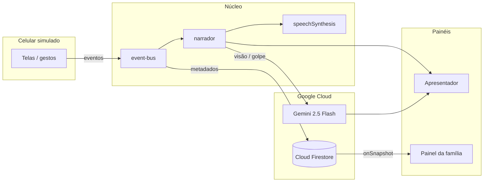

# Arquitetura — Neto Digital

## Visão geral

A demo é um front-end estático (HTML/CSS/JS módulos ES) que simula um celular, narra ações em voz alta e registra metadados no Cloud Firestore. A IA (Google Gemini) entra só em momentos-chave: visão da tela e classificação de golpe.

## Módulos

| Pasta | Responsabilidade |
|-------|------------------|
| `js/core` | Estado, event-bus, bootstrap |
| `js/services` | Gemini, visão, Firebase, voz, localStorage |
| `js/narrator` | Decisão de fala, frases, memória, golpes |
| `js/phone` | Telas do aparelho simulado |
| `js/accessibility` | Silenciar e modo discreto |
| `js/presenter` | Selos GS e simulações |
| `js/dashboard` | Métricas e gráficos |

## Fluxo de um toque

1. Usuário toca um botão no celular.
2. O módulo da tela emite `ui:action` no event-bus.
3. O narrador decide a fala (local ou Gemini) e a prioridade.
4. `speech.service` enfileira a voz; a legenda atualiza.
5. `firebase.service` grava metadados (ou cai no `localStorage`).
6. Selos do apresentador acendem conforme a tecnologia usada.

## Fallbacks

- Sem chave Gemini → regras locais e frases em `phrases.js`.
- Sem Firestore → `storage.service` (localStorage).
- Timeout da IA (4 s) → continua a demo sem travar.
